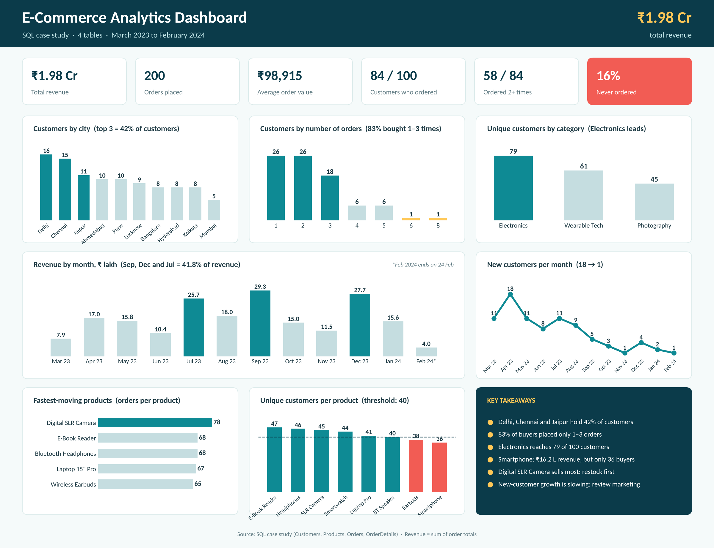

# E-commerce Sales Analysis (SQL)

A SQL case study on an e-commerce company's customers, products, orders and revenue, answering ten business questions with joins, CTEs and window functions.

## Problem

Where should an online retailer focus its marketing, stock and pricing? The analysis covers customer geography, repeat buying, product reach, sales trends and inventory.

## Data

Four related tables:

| Table | Rows | Contents |
|-------|------|----------|
| Customers | 100 | customer id, name, city |
| Products | 8 | product id, name, category, price |
| Orders | 200 | order date, customer, total amount |
| OrderDetails | 519 | order lines: product, quantity, unit price |

Period: March 2023 to February 2024. Total revenue: Rs 1.98 crore.

## SQL techniques used

- Aggregations: COUNT, SUM, AVG, with GROUP BY and HAVING
- Multi-table JOINs
- CTEs (WITH clause)
- Window function: LAG, for month-on-month change
- Subquery in HAVING
- Monthly date grouping with LEFT(order_date, 7)

## Key findings

- **Delhi, Chennai and Jaipur** hold 42 of the 100 customers (16, 15 and 11).
- **83% of buyers** placed only 1 to 3 orders; 16 registered customers never ordered.
- **Electronics** reaches the most customers (79 of 100).
- **Smartphone** earns Rs 16.2 lakh from about 2 units per order, but only 36 customers bought it.
- **Digital SLR Camera** is the fastest mover (78 orders), so it needs frequent restocking.
- **September, December and July** are the peak sales months (41.8% of revenue).
- **New-customer growth slowed** from 18 a month in April 2023 to 1 by February 2024.

## Files

- [e-commerce_case_study.sql](e-commerce_case_study.sql): all queries, with the business question above each
- [e-commerce-company-dataset.xlsx](e-commerce-company-dataset.xlsx): the dataset (four sheets)
- [E-Commerce_Analytics_SQL.pdf](E-Commerce_Analytics_SQL.pdf): the presentation

## Limitation

February 2024 data ends on 24 February, so that month looks smaller than it is.
