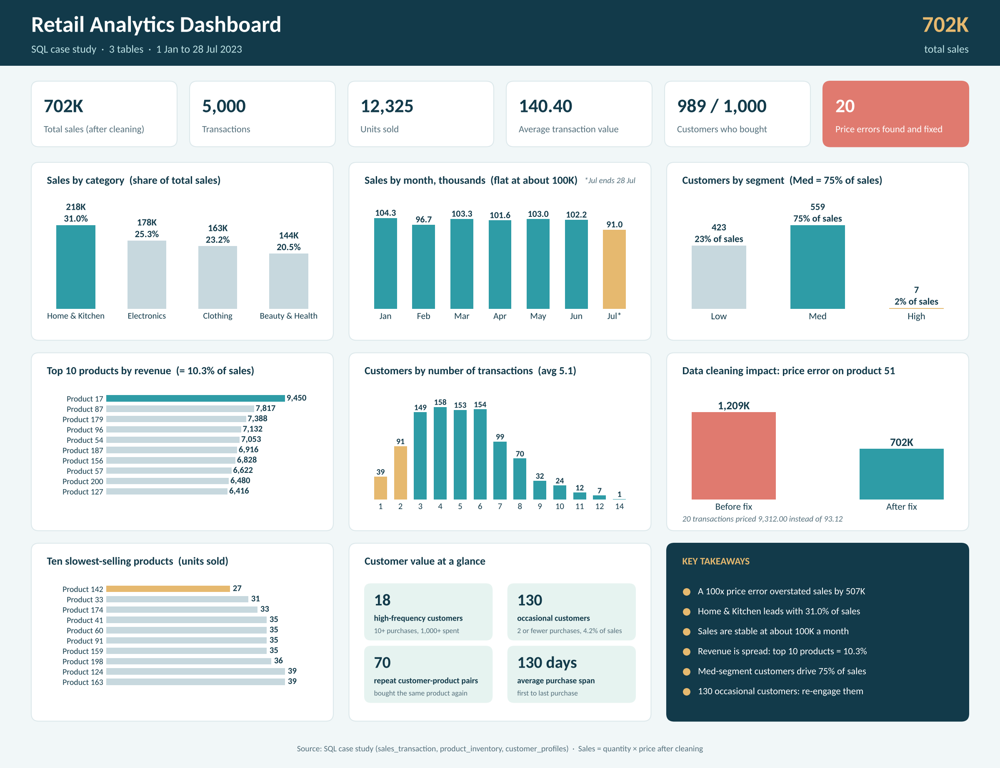

# Retail Analytics (SQL)

A SQL case study on a retail company's transactions, products and customers. It cleans the data first, then finds what sells, when it sells, and which customers drive revenue.

## Problem

Can the company trust its sales data, and where should it focus products, promotions and customers? The analysis cleans four data issues, then covers product and category performance, the sales trend and customer segmentation.

## Data

| Table | Rows | Contents |
|-------|------|----------|
| sales_transaction | 5,002 raw (5,000 after cleaning) | customer, product, quantity, date, price |
| product_inventory | 200 | product name, category, stock level, price |
| customer_profiles | 1,000 | age, gender, location, join date |

Period: 1 January to 28 July 2023. The data is loaded into MySQL.

## Data cleaning

| # | Issue | Fix |
|---|-------|-----|
| 1 | 2 duplicate transactions | Kept one copy with DISTINCT |
| 2 | 20 transactions for product 51 priced 9,312.00 instead of 93.12 | Updated to the catalogue price with a JOIN |
| 3 | 13 customer profiles with no location | Labelled "Unknown" |
| 4 | Dates stored as DD/MM/YY text | Converted with STR_TO_DATE |

The price error alone overstated total sales: they fall from about 1.21 million to 702 thousand after the fix.

## SQL techniques used

- Data cleaning: DISTINCT, UPDATE with JOIN, STR_TO_DATE, CREATE TABLE ... AS, RENAME TABLE
- Aggregation: SUM, COUNT, AVG with GROUP BY and HAVING
- Multi-table JOINs
- CTEs (WITH clause)
- Window function: LAG, for month-on-month growth
- CASE, for customer segmentation
- DATEDIFF, for purchase span

## Key findings

- **Home & Kitchen** is the largest category with 31.0% of sales; Beauty & Health is smallest at 20.5%.
- **Revenue is spread widely:** the top 10 products make up only 10.3% of sales.
- **Sales are steady** at about 100 thousand a month from January to June. July looks lower only because the data ends on 28 July.
- **Customers buy about five times each:** 989 of 1,000 customers bought at least once.
- **The Med segment** (11 to 30 units) holds 559 customers and generates about 75% of sales.
- **130 occasional customers** bought twice or less and generate only 4.2% of sales.

## Files

- [retail_analytics_case_study.sql](retail_analytics_case_study.sql): all queries, with the business reason above each
- [Retail_Analytics_SQL_Case_Study.pdf](Retail_Analytics_SQL_Case_Study.pdf): the presentation
- sales_transaction.csv, product_inventory.csv, customer_profiles.csv: the data

## How to run

1. Import the three CSV files into MySQL as tables with the same names.
2. Run the sections of the SQL file in order, starting with section 1 (data cleaning).

## Limitations

- The currency is not stated in the data.
- July 2023 ends on 28 July, so that month looks smaller than it is.
- The inventory price is treated as the correct price.
