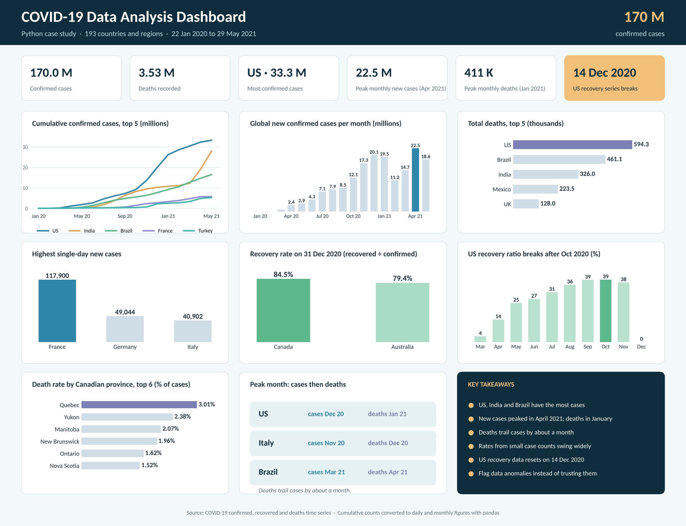

# COVID-19 Data Analysis (Python)

A Python case study on global COVID-19 records from January 2020 to May 2021. It cleans and reshapes three time-series tables with pandas, then analyses cases, recoveries and deaths by country and by month.

## Problem

How did COVID-19 spread across countries, how deadly was it, and can the data be trusted? The analysis covers case growth, recovery and death rates, monthly waves, and a data-quality check.

## Data

- Three sheets: confirmed cases, recovered cases and deaths
- 193 countries and regions
- 494 days of cumulative daily counts (22 Jan 2020 to 29 May 2021)
- About 170 million confirmed cases and 3.5 million deaths in total

## Approach

1. **Loaded and explored** the three sheets with pandas.
2. **Cleaned** missing values: forward-filled one-day gaps, labelled blank provinces and excluded a cruise ship from country rankings.
3. **Reshaped** the wide tables to long format with melt and merged them into one country-by-date table.
4. **Analysed** trends, peaks, rates and monthly totals.
5. **Visualised** the results with Matplotlib.

## Key findings

- **The US, India and Brazil** have the most confirmed cases: 33.3, 27.9 and 16.5 million.
- **New cases peaked in April 2021** at about 22.5 million that month; deaths peaked in January 2021.
- **Deaths trailed cases by about a month** in the US, Italy and Brazil.
- **Canada's recovery rate** was 84.5% at the end of 2020, against 79.4% for Australia.
- **US deaths** total about 594 thousand, an average of 1,205 a day, the highest of any country.
- **Data-quality issue:** the US recovery series drops from 6.3 million to zero on 14 December 2020, so later US recovery ratios could not be calculated.

## Python tools used

pandas (cleaning, melt, merge, groupby), Matplotlib (charts)

## Files

- [COVID-19_Case_Study.ipynb](COVID-19_Case_Study.ipynb): the full analysis with outputs
- [COVID-19_Data_Analysis_Python_Case_Study.pdf](COVID-19_Data_Analysis_Python_Case_Study.pdf): the presentation
- covid_19_dataset.xlsx: the data

## How to run

1. Place `covid_19_dataset.xlsx` in the same folder as the notebook.
2. Install the libraries with `pip install pandas matplotlib openpyxl`.
3. Open the notebook in Jupyter and run all cells.

## Limitations

- Counts are cumulative and depend on each country's reporting.
- The US recovery data is unreliable after 14 December 2020.
- Single-day peaks can reflect reporting batches rather than real spikes.
